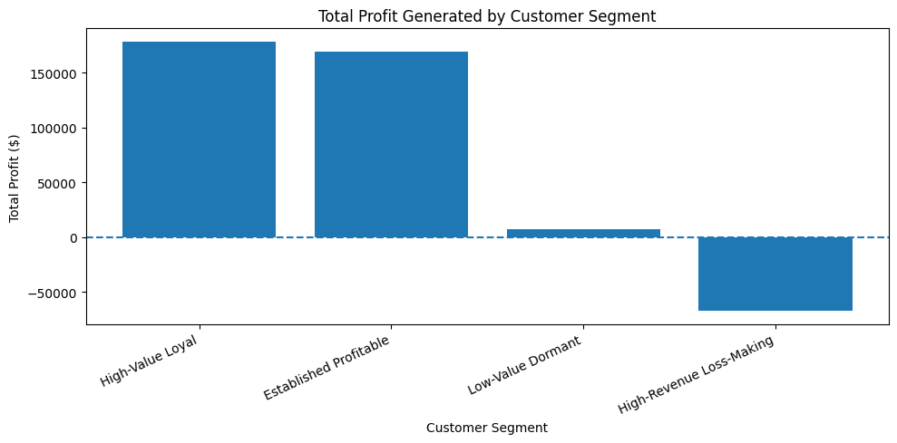
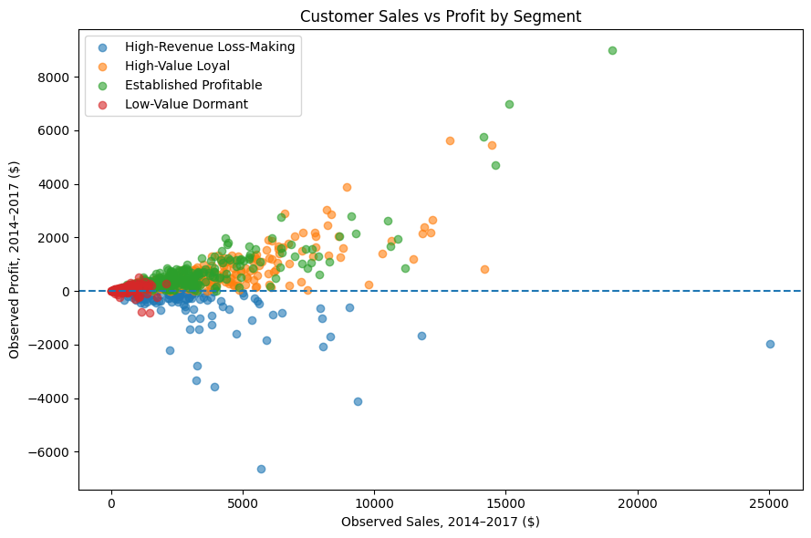
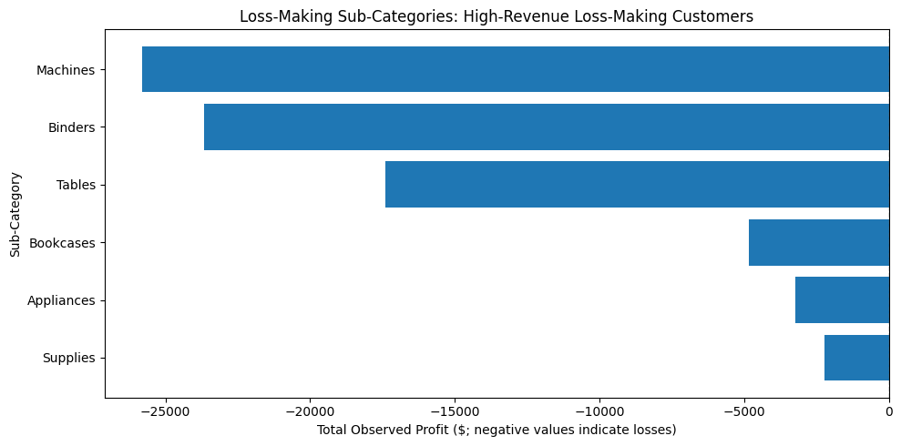
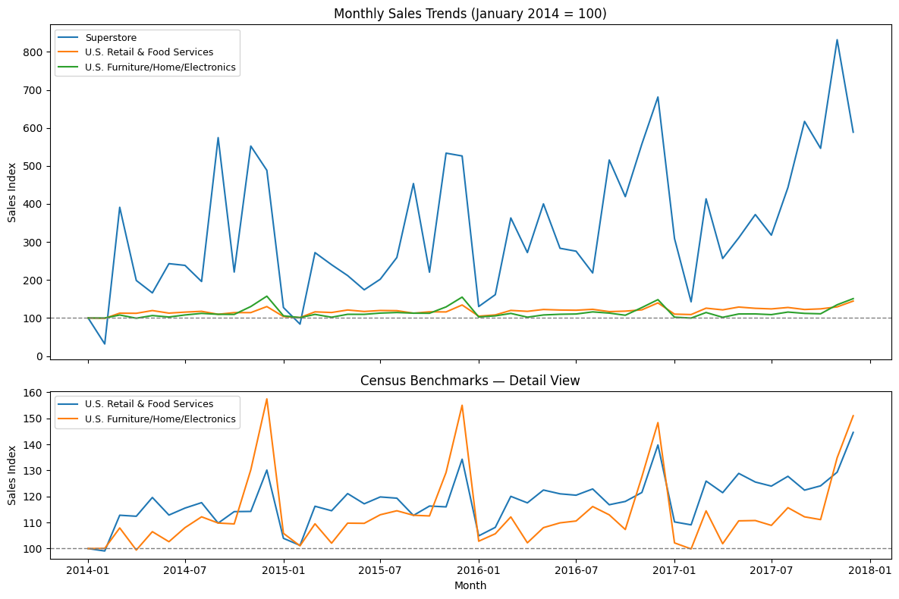

# Retail Customer Segmentation & Profitability Analysis

**Python · pandas · RFM analysis · K-means clustering · Profitability analysis · U.S. retail benchmarking**

A reproducible customer analytics project exploring how retailers can **prioritise marketing and retention resources using purchasing behaviour *and* profitability**, rather than relying on sales revenue alone.

> **Key finding:** A group representing **15.9% of customers (126 of 793)** generated **$375,296.52 in sales** but **lost $67,478.17 in profit** over the observed 2014–2017 transaction history. High spending did not necessarily mean high customer value.

The analysis combines customer-level RFM features with observed Profit, evaluates alternative K-means solutions, investigates discount and product-level loss drivers, and compares monthly sales patterns with U.S. Census retail statistics.



## Business problem

Retailers often use purchasing frequency and spending to identify customers for campaigns. But a customer generating substantial sales may also generate losses, particularly where margins differ across products and discounts. Prioritising customers by revenue alone can therefore misallocate limited marketing resources.

**Business question:** *How should a retailer use customer purchasing data to segment its customer base and prioritise marketing spend and retention activity while protecting profitability?*

The goal is **descriptive decision support**, not prediction of true customer lifetime value or causal estimation of campaign ROI.

## Data sources

| Source | Scope and grain | Use in this analysis |
|---|---|---|
| [Superstore dataset (Kaggle, vivek468)](https://www.kaggle.com/datasets/vivek468/superstore-dataset-final) | **9,994 transaction lines**, **21 original columns**, **793 unique customers**; orders dated **3 January 2014–30 December 2017** | Customer purchasing patterns, RFM features, discounts, product mix and profitability |
| [U.S. Census Bureau — Monthly Retail Trade Survey](https://www.census.gov/retail/data.html) | Two **monthly, not seasonally adjusted** series; **48 observations per series** from January 2014–December 2017 | Broad external context using total retail and food services, and furniture/home furnishings/electronics/appliance store sales |

Superstore rows represent **order lines, not necessarily unique orders**. An order can span multiple lines, so customer purchase frequency uses **distinct `Order ID` values**. Initial validation found **no missing values** and **no exact duplicate rows** in the supplied Superstore file.

Census figures are **national aggregates**, not matched observations from the Superstore business. The Census data provides context, **not a validation dataset for the customer clusters**. Census series can be revised over time; reproducing the published numerical results requires the same workbook vintage and layout. See [data setup notes](data/README.md).

**Data availability:** Source datasets are *not redistributed* in this repository. Download them from their respective providers and observe the providers' terms of use. The original Superstore dataset includes customer-name fields; do not treat these sample records as verified real customers.

## Analysis workflow

1. **Load and validate data:** review structure, types, missingness, duplicates, descriptive statistics and transaction dates.
2. **Explore transactions:** examine Sales, Profit, Discount and ordering frequency, including skewness and loss-making lines.
3. **Engineer RFM + Profit:** aggregate 9,994 order lines into 793 customer records.
4. **Prepare model features:** transform skewed variables and standardise features before distance-based clustering.
5. **Evaluate K-means:** compare K=2–8 using inertia (elbow) and average silhouette scores; inspect K=3 versus K=4 profiles.
6. **Profile segments:** quantify group size, recency, order frequency, customer sales and observed profitability.
7. **Diagnose loss drivers:** review discount exposure and profitability by product sub-category, region and category.
8. **Benchmark market patterns:** extract 2014–2017 Census series, index all three monthly sales series to January 2014 = 100, compare volatility and calculate correlations.

### RFM + Profit feature engineering

| Feature | Operational definition |
|---|---|
| **Recency (R)** | Days since a customer's most recent order, measured against **31 December 2017**; lower is more recent |
| **Frequency (F)** | Count of **distinct Order IDs** placed by each customer |
| **Monetary (M)** | Sum of each customer's observed **Sales** across 2014–2017 |
| **Profit (P)** | Sum of each customer's observed **Profit**, allowing negative customer contribution to remain visible |

RFM quartile scores are calculated for descriptive interpretation. **K-means is fitted to the four continuous R, F, M and Profit variables—not the combined RFM score or an inferred lifetime-value estimate.**

### Transformations and model selection

- Apply `log1p` to **Recency, Frequency and Monetary** to reduce positive skew.
- Apply a **signed-log transformation** to Profit: `sign(profit) × log1p(abs(profit))`. This reduces magnitude disparities while retaining negative values.
- Standardise the four transformed features with `StandardScaler`.
- Fit K-means models for **K=2 through K=8**, using `random_state=42` and `n_init=20`.

**K=3 produced the highest silhouette score (0.3475)**, compared with **0.2713 for K=4**. The final analysis deliberately retains **K=4** because its profiles separate active, profitable customers from less-recent but still profitable customers. Those groups suggest materially different retention versus re-engagement actions. K=4 is an **interpretability trade-off**, not the statistically best-separated solution or proof that four natural customer types exist.

## Results: four customer segments

| Segment | Customers | Customer share | Average recency (days) | Average orders | Observed sales | Observed profit |
|---|---:|---:|---:|---:|---:|---:|
| **High-Value Loyal** | 257 | 32.4% | 31.00 | 8.00 | $1,006,348.24 | **+$178,086.08** |
| **Established Profitable** | 278 | 35.1% | 199.76 | 6.27 | $838,674.27 | **+$168,813.92** |
| **Low-Value Dormant** | 132 | 16.6% | 279.07 | 3.06 | $76,881.83 | **+$6,975.19** |
| **High-Revenue Loss-Making** | 126 | 15.9% | 133.89 | 6.38 | $375,296.52 | **−$67,478.17** |

*Totals cover only the **observed 2014–2017 history**. They are not predicted customer lifetime value. “Profit” uses the supplied transaction-level Profit field; a fully loaded net contribution measure would also require costs not provided in the data.*



### Profitability and discount findings

- **Revenue is not a reliable stand-alone targeting rule.** The loss-making segment generated roughly **$375k** in Sales while recording roughly **$67.5k** in losses.
- **The loss-making segment had the highest mean transaction-line discount: 22.3%**, versus 14.7% for High-Value Loyal and 13.5% for Established Profitable. These are simple **line-level averages**, not sales-weighted discount rates.
- Within that loss-making segment, **Machines (−$25,806.46)**, **Binders (−$23,672.14)** and **Tables (−$17,408.47)** were the largest loss-making sub-categories. Their respective mean transaction-line discounts were approximately **52%, 49% and 35%**.
- Across all transactions, observed discount levels from **30% to 80%** had negative *average transaction-line Profit* in this sample. This association does **not** establish that discounts themselves caused the losses; product mix, customer selection and other factors may confound the relationship.



### External retail-market analysis

For January 2014–December 2017, the notebook compares monthly Superstore Sales with two U.S. Census Monthly Retail Trade Survey benchmarks. All series are indexed to **January 2014 = 100** because dollar scales differ substantially.

| Market-context metric | Result |
|---|---:|
| Correlation: Superstore vs total U.S. retail and food services | **0.645** |
| Correlation: Superstore vs furniture/home furnishings/electronics/appliances | **0.690** |
| Coefficient of variation: total U.S. retail | **7.85%** |
| Coefficient of variation: furniture/home furnishings/electronics benchmark | **12.55%** |

Superstore's indexed monthly Sales fluctuate more sharply than the two aggregate market series. The positive correlations indicate some co-movement, but **cannot establish why Superstore sales changed**. The Census series are **not seasonally adjusted**; seasonal movement remains part of the comparison.



## Recommended business actions

| Segment | Suggested response | Commercial rationale |
|---|---|---|
| **High-Value Loyal** | Prioritise retention, service quality and relationship development | Strong observed purchasing recency, frequency and profit |
| **Established Profitable** | Test targeted re-engagement and win-back messaging | Meaningful historical profit, but substantially longer average time since purchase |
| **Low-Value Dormant** | Use low-cost reactivation tests before committing significant incentives | Lower purchasing frequency and observed contribution |
| **High-Revenue Loss-Making** | Review offer eligibility, discount rules and loss-making product/customer combinations before further promotional investment | Strong revenue masks negative observed profit |

These are **prioritisation hypotheses**, not demonstrated campaign effects. Before scaling investment, collect campaign exposure, treatment/control status, offer value, communication cost, conversion and subsequent profit to estimate incremental outcomes.

## Limitations and next steps

- **Historical and illustrative data:** 2014–2017 sample transactions should not be taken as representative of a current retail business.
- **Observed, not lifetime, value:** There are no post-period customer outcomes, acquisition/servicing costs or predicted future cash flows.
- **No causal inference:** Neither the discount–Profit association nor the Census sales correlations identify causal effects. Marketing ROI and uplift cannot be calculated without intervention and cost data.
- **Clustering is model-dependent:** Results depend on feature selection, scaling, K and the underlying sample. K=4 was retained for commercial interpretability despite a weaker silhouette score.
- **Benchmark mismatch:** Census aggregates cover the national retail market at a different granularity and product mix than Superstore; the comparison does not verify customer segmentation.
- **Data-source vintages:** Census revisions and workbook-layout changes can affect reproducibility when downloading the data later.

Potential extensions include out-of-time validation, clustering stability checks, sales-weighted versus line-weighted discount comparisons, richer margin/cost data, governed campaign experiments, causal uplift estimation and forward-looking customer-value modelling.

## Technologies and skills

**Tools:** Python, Jupyter Notebook / Google Colab, pandas, NumPy, Matplotlib, Seaborn, scikit-learn and openpyxl.

**Demonstrated skills:** Data cleaning and validation; exploratory analysis; customer aggregation; RFM feature engineering; transformations and scaling; unsupervised learning; elbow and silhouette evaluation; cluster interpretation; profitability and discount diagnostics; time-series indexing; external-data integration; correlation and volatility analysis; and converting results into commercially relevant actions.

## Run the notebook

**Prerequisite:** Python 3.10+ and a notebook environment such as VS Code (with the Jupyter extension), Jupyter or Google Colab.

1. Clone or download this repository.
2. Create a Python environment and install the project dependencies:

   ```bash
   python -m venv .venv
   # Windows PowerShell:
   .venv\Scripts\Activate.ps1
   pip install -r requirements.txt
   ```

3. Create a `data/` directory if it does not already exist, and place these **exact filenames** inside it:
   - `data/Superstore.csv` — download from [Kaggle](https://www.kaggle.com/datasets/vivek468/superstore-dataset-final) and rename the file if necessary.
   - `data/Census.xlsx` — obtain the corresponding [Census MRTS data workbook](https://www.census.gov/retail/data.html). The notebook expects **year-named worksheets** (`2014`, `2015`, `2016`, `2017`) with **NOT ADJUSTED** sections and months in columns C:N. See [data/README.md](data/README.md).
4. Open `retail_customer_segmentation.ipynb` in a notebook environment, select the environment and choose **Run All** from the repository root.

**Reproducibility checks:** Expect 9,994 Superstore order lines, 793 unique customers, 48 observations for each extracted Census series, and the four customer groups shown above. If the downloaded Census file has a different sheet structure or revision, the extraction code may need corresponding input-format changes; do not assume different vintages will yield identical values.

### Repository layout

```text
retail-customer-segmentation/
├── README.md
├── retail_customer_segmentation.ipynb
├── requirements.txt
├── .gitignore
├── LICENSE
├── data/
│   └── README.md                 # Source/setup notes (raw datasets excluded)
└── images/
    ├── segment_profitability.png
    ├── customer_sales_vs_profit.png
    ├── loss_making_subcategories.png
    └── us_retail_benchmark.png
```

## License and attribution

Code and original project documentation are provided under the [MIT License](LICENSE). **Third-party datasets are not included in that license**; their original providers retain their applicable rights and terms. Data sources are credited above.

## Author

**Abdullah Asif** · LinkedIn: **https://www.linkedin.com/in/abdullah-asif-948b71246/** ·

*This is an independent portfolio analysis of a historical retail sample. Its descriptive findings are intended to illustrate analytics-driven decision making, not to imply current operating results or causal business impact.*
